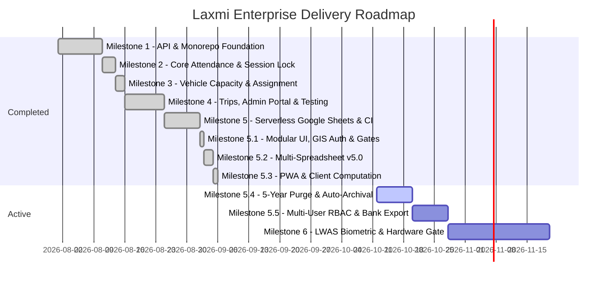

# Laxmi Enterprise Goals & Milestones

**Last Updated:** October 12, 2026  
**Status:** Milestones 1–5.3 Complete, Milestone 5.4 & 5.5 In Progress (5-Year Data Retention & Multi-User RBAC Architecture)

---

## 1. Product Goal

Deliver a resilient, high-speed attendance, fleet capacity, vehicle trip lifecycle, and payroll intelligence platform for Laxmi Enterprise's daily workforce of 120–150+ workers across quarry, yard, transport, and office operations.

**Guiding Mandate:**
- **100% Free Forever:** Zero server costs, zero database subscription fees, operating permanently within free storage allowances (<2GB total footprint).
- **Multi-User Scalability:** Seamless concurrency for multiple supervisors, accountants, administrators, and workers.
- **5-Year Rolling Lifecycle:** Automatic deletion/archival of records older than 5 years to guarantee perpetual high performance and sub-50MB active database size.

---

## 2. Architecture & Free-Tier Scalability Goals

1. **Permanent Zero-Cost Infrastructure**:
   - Host frontend statically on GitHub Pages / Cloudflare Pages (unlimited free bandwidth).
   - Partition data across zero-cost serverless storage (Google Drive 15 GB free tier / Cloudflare D1 5 GB free tier).
   - Maintain total active storage footprint well under the 2 GB threshold.
2. **5-Year Automated Data Retention**:
   - Automatically delete raw daily attendance, vehicle trips, and audit logs older than 5 years (1,825 days).
   - Compile annual compliance aggregates prior to raw data pruning.
   - Maintain active database size under **50 MB** indefinitely.
3. **Installable Progressive Web App (PWA)**:
   - Deliver standalone installable web apps for Android tablets, smartphones, and desktop computers with offline caching and service worker lifecycle management.
4. **Client-Centric Heavy Computation**:
   - Execute 100% of calculation-heavy algorithms (1.5x overtime wage formulas, contractor agency settlements, knapsack cargo capacity optimization, conflict checks) on the client device CPU via `ClientComputationService`.
5. **Multi-User Concurrency & Micro-Batching**:
   - Replace chatty row-by-row writes with atomic micro-batching to eliminate lock contention when multiple supervisors submit shifts simultaneously.

---

## 3. Role-Based Access Control (RBAC) Goals

1. **`Admin` / `Owner`**:
   - Full master data control (employee directory, base wage rates, 1.5x overtime multiplier).
   - Final payroll approval and contractor agency commission settlements.
   - Emergency session unlock authority and full audit log inspection.
2. **`Accountant` / `HR`**:
   - Monthly attendance reconciliation and shift audit.
   - Automated payroll calculation and 1-click Bank Bulk Transfer CSV exports (NEFT/RTGS).
   - Individual salary slip issuance and wage dispute adjustments.
3. **`Supervisor` (Floor / Yard Manager)**:
   - Touch-first daily shift attendance (On Time, Arrived, Absent).
   - Vehicle capacity allocation (max 8 passengers: 1 Driver, 1 Chalan Man, 6 Workers).
   - Trip dispatch, site arrival, delivery verification, and return tracking.
   - Offline-first mutation queue with automatic background sync.
4. **`Worker` (Self-Service)**:
   - Read-only digital punch verification and monthly attendance history.
   - Mobile-friendly digital pay slip download.

---

## 4. Attendance & Session Goals

1. **Daily Session Isolation**: Create exactly one attendance session per date and shift (e.g. `SES-2026-10-12-Morning`).
2. **Deterministic Statuses**: Record each employee once per session as **On Time**, **Arrived** (with mandatory arrival time), or **Absent**.
3. **Optimistic & Fast Entry**: Allow supervisors to mark attendance rapidly with immediate tactile feedback, reconciling with the backend asynchronously.
4. **Audited Finalization & Locking**: Finalize sessions via the backend to lock further edits. Support emergency unlocks exclusively through authenticated Admin approval with full audit logs.
5. **Immutable Audit Trail**: Record actor, timestamp, previous value, and new value for every attendance transition in `Audit_Logs`.

---

## 5. Vehicle Capacity & Assignment Goals

1. **Present-Only Assignments**: Permit vehicle assignment only to employees marked present (`on_time` or `arrived`) in the active session.
2. **Strict Capacity Enforcement**:
   - Max 1 Driver per vehicle
   - Max 1 Chalan Man per vehicle
   - Max 6 Workers / Extra Labour per vehicle
   - Max 8 total employees per vehicle
3. **Client Knapsack Optimization**: Client computation algorithms pack and optimize passenger and payload allocations without server lag.
4. **Conflict Resolution**: Return structured capacity violation details enabling supervisors to resolve conflicts directly in the UI.

---

## 6. Vehicle Trip & Task Completion Lifecycle Goals

1. **End-to-End Delivery Tracking**: Track vehicle tasks through their complete lifecycle:
   - **Dispatched**: Vehicle departs yard/quarry with driver and material load.
   - **Reached Location**: Vehicle arrives at designated customer site or unloading zone.
   - **Delivered Product**: Material / aggregate delivery completed and receiver verified.
   - **Returned / Completed**: Vehicle returns to base and becomes available for new dispatch.
2. **Timeline History**: Record every milestone event with timestamp, acting user, and optional site remarks.
3. **Operational Visibility**: Display active trips in real time on both supervisor tablets and admin portal.

---

## 7. Administrative & Payroll Intelligence Goals

1. **Date Range Analytics**: Provide flexible date range filters (Today, 7 Days, 30 Days, Custom Range) for attendance and fleet trends.
2. **Client-Side Automated Payroll Engine**: Compute daily base wage and overtime / extra duty compensation dynamically according to category wage presets and 1.5x overtime multiplier on the client device.
3. **Statutory Bank Exports**: 1-click export of bank-ready NEFT/RTGS payment sheets matching standard Indian bank formats (Account Number, IFSC, Employee Name, Net Amount).
4. **Instant Data Portability**: Provide robust CSV exports for employee payroll, attendance summaries, and fleet utilization.

---

## 8. Delivery Milestones

### Milestone 5.4 — 5-Year Data Lifecycle & Auto-Archival Engine 🔄
- Automated monthly scheduled trigger to prune attendance and trip records older than 5 years.
- Annual summary compilation before raw record deletion to preserve historic payroll compliance totals.
- Database vacuum and compaction routine to maintain <50 MB active working footprint.

### Milestone 5.5 — Multi-User RBAC & Bank Transfer Export 🚀
- Role guards for `Admin`, `Accountant`, `Supervisor`, and `Worker`.
- Micro-batching write queue in `ClientComputationService` and `googleSheetsService`.
- 1-click Bank Transfer CSV export module supporting SBI, Axis, and HDFC bulk payroll templates.
- Digital mobile-friendly salary slip viewer for individual workers.
