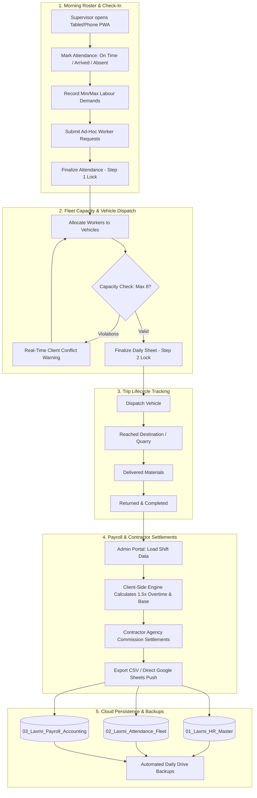
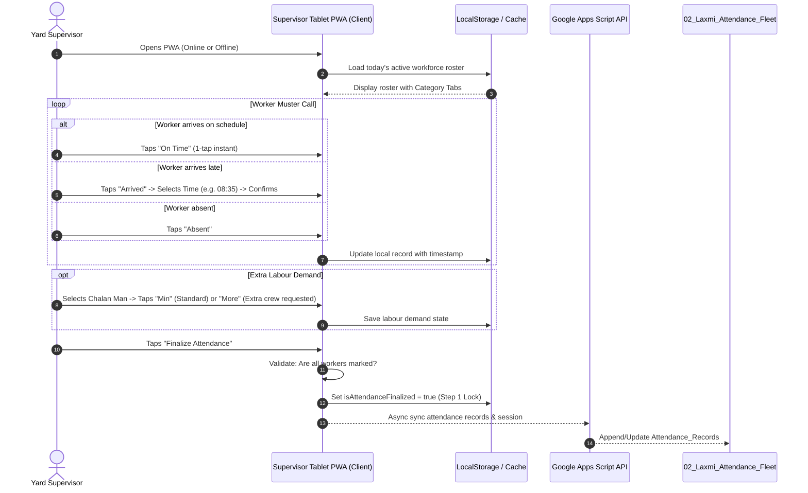
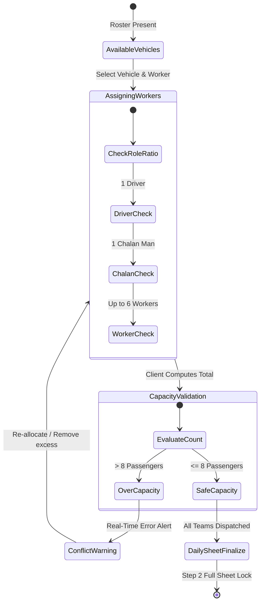
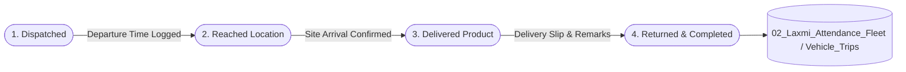
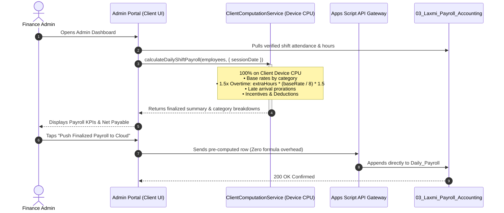
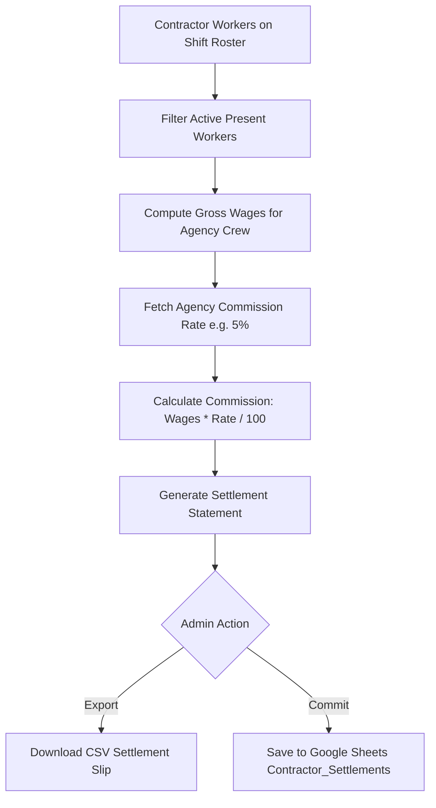
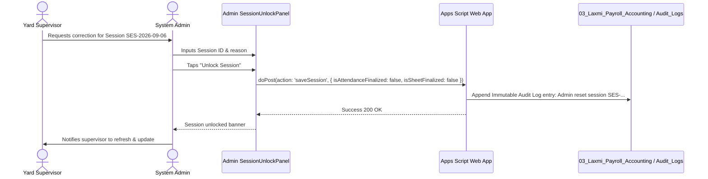
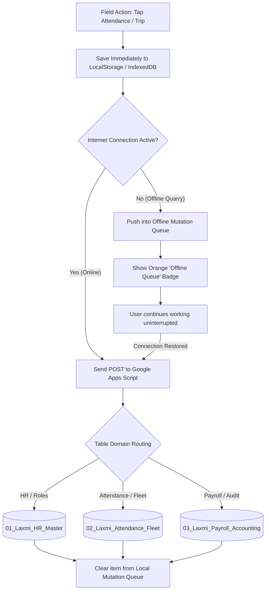

# Laxmi Enterprise — Complete Operational & Technical Workflows

**Version:** 5.0 (Modular Multi-Spreadsheet & Client-Side PWA Architecture)  
**Last Updated:** September 6, 2026  
**Target Environments:** Android Tablet/Smartphone (PWA) & Office Desktop Workstations  
**Cloud Database:** Google Sheets (3 Partitioned Domain Spreadsheets in Google Drive)

---

## System Workflow Map Overview

---

## Workflow 1: Daily Shift Attendance & Check-In Lifecycle

**Actor:** Field/Godown Supervisor (`Maalaxmi.godown@gmail.com`)  
**Device:** Android Tablet (dallied or landscape) or Android Smartphone (PWA)  
**Location:** Field Godown Yard / Quarry Muster Point  

### Steps & Business Rules:
1. **Instant Offline Attendance**: Supervisor records worker presence with 0ms latency.
   - **`On Time`**: Full shift credit.
   - **`Arrived`**: Opens [`ArrivedTimeModal`](file:///D:/VisionLoop/Projects/LaxmiEnterprise/packages/shared/components/ArrivedTimeModal.jsx) to log actual arrival time and remarks.
   - **`Absent`**: Zero hours earned.
2. **Min/Max Labour Demand Verification**: Chalan Men require equipment transport and delivery support. Supervisors capture whether standard (*Minimum*) or surge (*More Labour*) crew is needed.
3. **Step 1 Lock**: Once finalized, attendance buttons are locked to prevent inadvertent field tampering.

---

## Workflow 2: Fleet Allocation & Vehicle Capacity Dispatch

**Actor:** Field/Godown Supervisor (`Maalaxmi.godown@gmail.com`)  
**Objective:** Assign present workers to vehicles while strictly enforcing vehicle safety rules and maximum passenger limits.

### Constraints Enforced 100% on Client Device:
- **Maximum Capacity**: Exactly **8 passengers** per vehicle (hard physical limit for tippers/vans).
- **Role Ratio**: Optimal crew composition is **1 Driver**, **1 Chalan Man**, and **up to 6 General Workers**.
- **Instant Conflict Alerts**: If supervisor accidentally assigns 9 workers or 2 drivers to the same vehicle, the client immediately flashes an amber/red warning banner without contacting the server.
- **Step 2 Full Lock**: Supervisor taps **"Finalize Daily Sheet"**, locking all vehicle allocations and extra labour requests.

---

## Workflow 3: Vehicle Trip Lifecycle & Task Progression

**Actor:** Yard Supervisor / Dispatcher  
**Component:** [`TripTrackerModal.jsx`](file:///D:/VisionLoop/Projects/LaxmiEnterprise/apps/supervisor/src/components/TripTrackerModal.jsx)  

### Trip State Machine:
1. **`Dispatched`**: Vehicle departs godown yard. Departure timestamp recorded automatically.
2. **`Reached Location`**: Vehicle reaches customer unloading site, stone crusher, or depot.
3. **`Delivered`**: Material unloaded and quantity verified against chalan.
4. **`Returned`**: Vehicle returns to godown, odometer noted, trip marked closed.

---

## Workflow 4: Daily Shift Payroll & Overtime Calculation

**Actor:** Administrator / Finance Officer (`Gauravjaiswal0304@gmail.com`)  
**Engine:** [`ClientComputationService.js`](file:///D:/VisionLoop/Projects/LaxmiEnterprise/packages/shared/services/clientComputationService.js)  
**Portal:** Admin Portal (`apps/admin`)  

### Standard Compensation Matrix:
| Category | Base Daily Wage (8 Hours) | Overtime Rate (1.5×) | Role Responsibility |
| :--- | :--- | :--- | :--- |
| **Drivers** | **₹800 / day** | ₹150 / hour | Vehicle navigation, fuel oversight, transport safety |
| **Chalan Men** | **₹650 / day** | ₹121.88 / hour | Delivery verification, billing slips, customer sign-off |
| **Workers** | **₹500 / day** | ₹93.75 / hour | Loading, unloading, physical material handling |
| **Office Staff** | **₹750 / day** | ₹140.63 / hour | Weighbridge entry, documentation, admin tracking |
| **Extra Labour** | **₹450 / day** | ₹84.38 / hour | Ad-hoc contractor support during high-volume shifts |

---

## Workflow 5: Contractor Settlements & Agency Reconciliation

**Actor:** Administrator / Auditor  
**Sheets Target:** `03_Laxmi_Payroll_Accounting / Contractor_Settlements`  

---

## Workflow 6: Emergency Administrative Override & Session Unlock

**Actor:** Authorized Admin (`Gauravjaiswal0304@gmail.com`)  
**Component:** [`SessionUnlockPanel.jsx`](file:///D:/VisionLoop/Projects/LaxmiEnterprise/apps/admin/src/components/SessionUnlockPanel.jsx)  

> [!IMPORTANT]
> When a supervisor finalizes a shift attendance or daily sheet, records are locked on tablet devices to maintain field integrity. If late check-ins, vehicle breakdowns, or emergency adjustments occur, an Admin must execute the **Session Unlock Workflow**:

---

## Workflow 7: Multi-Spreadsheet Cloud Synchronization & Offline Queue

**Actor:** Client PWA Engine  
**Service:** [`googleSheetsService.js`](file:///D:/VisionLoop/Projects/LaxmiEnterprise/packages/shared/services/googleSheetsService.js)  

---

## Workflow 8: Quality Gate & GitHub Pages Continuous Delivery

**Actor:** Developer / Git Pre-Push Hook  
**Trigger:** `git push origin master`  

---

## Summary of Role Permissions Matrix

| Permission / Action | Godown Yard Supervisor (`Maalaxmi.godown@gmail.com`) | System Admin (`Gauravjaiswal0304@gmail.com`) |
| :--- | :---: | :---: |
| **Mark Daily Shift Attendance** | ✅ | ✅ |
| **Enter Late Arrival Times** | ✅ | ✅ |
| **Allocate Workers to Vehicles (Max 8)** | ✅ | ✅ |
| **Request Ad-Hoc Extra Workers** | ✅ | ✅ (Approve / Reject) |
| **Dispatch & Track Trips (1 to 4)** | ✅ | ✅ |
| **Finalize Daily Shift Sheet** | ✅ | ✅ |
| **Unlock Finalized Sessions** | ❌ (View only when locked) | ✅ |
| **Calculate & Edit 1.5x Overtime Rates** | ❌ | ✅ |
| **Contractor Commission Settlements** | ❌ | ✅ |
| **Export Financial CSVs & Payout Reports** | ❌ | ✅ |
| **Multi-Spreadsheet Cloud Configuration** | 👁️ (View status) | ✅ (Full provisioning & sync) |
